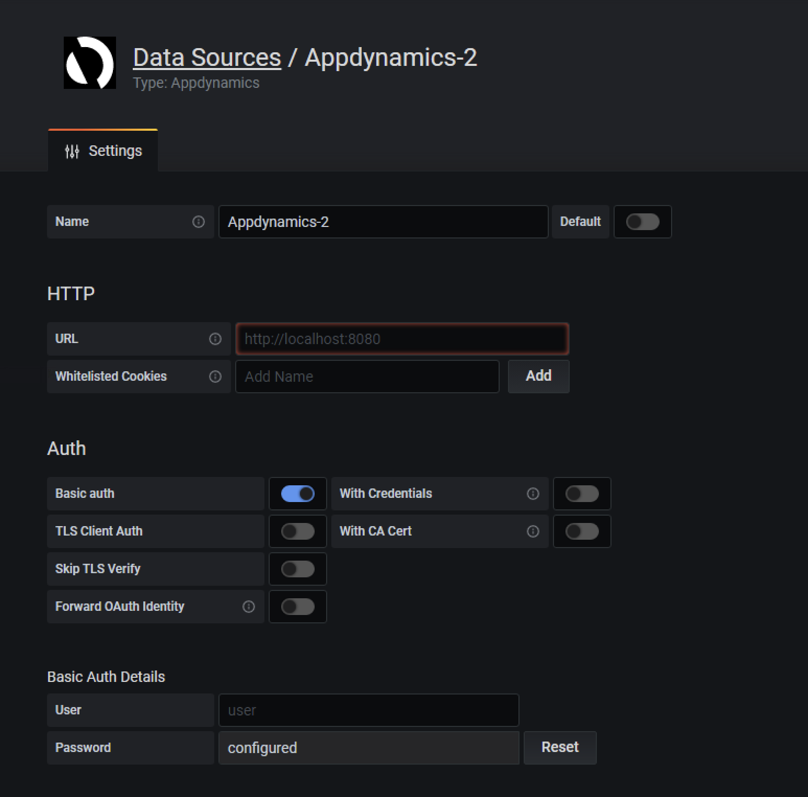
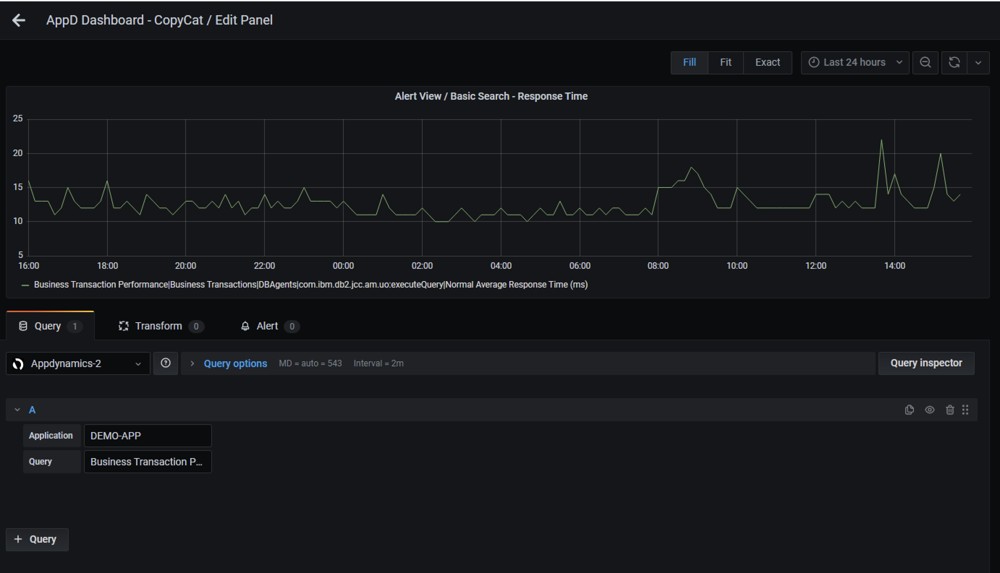

# AppDynamics Grafana Data Source Plugin

[](https://github.com/morganstanley/Plug-in-AppDynamics-Data-Source/actions/workflows/main.yml)

A Grafana data source plugin for [Splunk AppDynamics](https://docs.appdynamics.com/) controllers. It charts
metric time series, lists controller events and health rule violations, powers dashboard template
variables, and surfaces AppDynamics events as Grafana annotations — all through the AppDynamics
Controller REST API.




## Features

- **Metrics queries** — browse the metric hierarchy with cascading selectors (or hand-write paths
  with `*` wildcards and template variables), choose the statistic to chart
  (`value`/`min`/`max`/`sum`/`count`/`current`), toggle rollup, and template the legend with
  `{{application}}`, `{{metricPath}}`, `{{metricName}}`, or `{{N}}` (Nth path segment).
  Wildcard paths return one series per matching metric.
- **Events queries** — query controller events by type and severity, rendered as a table or
  consumed as Grafana annotations (title/text/tags/deep link).
- **Health rule violations** — list violations with start/end times, severity, and incident
  status; also annotation-ready.
- **Template variables** — variable queries for `applications`, `tiers(App)`, `nodes(App)`,
  `businessTransactions(App)`, and `metrics(App, Parent|Path)` (children of a metric path), with
  a structured variable editor. Multi-value variables expand to one request per value
  (applications × paths).
- **Annotations** — enable the data source in dashboard annotation settings; events and health
  rule violation queries emit annotation-shaped frames out of the box.
- **Backward compatible** — dashboards saved with the previous plugin versions
  (`queryText`/`metricSegments` queries) are migrated automatically.

## Configuring the data source

1. Set the URL to your controller root, e.g. `https://<account>.saas.appdynamics.com`
   (the plugin calls `/controller/rest/...` beneath it).
2. Enable **Basic auth**. The user name must use the AppDynamics REST format
   `username@account` (e.g. `apiuser@customer1`).
3. **Save & test** verifies connectivity and reports how many applications are visible.

All requests are proxied through the Grafana server (data source proxy); credentials never reach
the browser.

## Getting started (development)

Requires Node.js 22+.

1. Install dependencies

   ```bash
   npm install
   ```

2. Build plugin in development mode

   ```bash
   npm run dev
   ```

3. Unit Testing

   ```bash
   npm run test        # watch mode
   npm run test:ci     # single pass
   ```

4. Build plugin in production mode

   ```bash
   npm run build
   ```

5. Lint and typecheck

   ```bash
   npm run lint
   npm run typecheck
   ```

6. Run a local Grafana with the plugin

   ```bash
   npm run server
   ```

## Contribution Guide

### Become a contributor

You can contribute to us in several ways. Here are some examples:

- Contribute to the codebase.
- Report and triage bugs.
- Develop community plugins and dashboards.
- Write technical documentation and blog posts, for users and contributors.
- Organize meetups and user groups in your local area.
- Help others by answering questions about this plugin.

For more ways to contribute, check out the [Open Source Guides](https://opensource.guide/how-to-contribute/).

### Contributing

If you are interested in contributing with bug fixes, new features or coding in general, please
refer to the [CONTRIBUTING](./CONTRIBUTING.md) guidelines.
